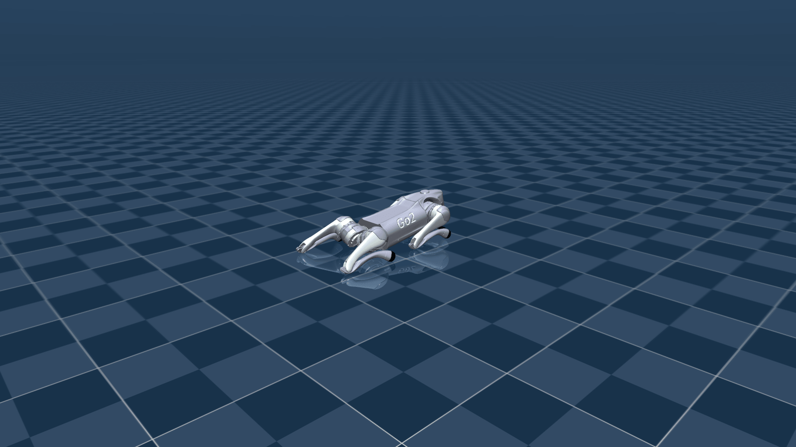
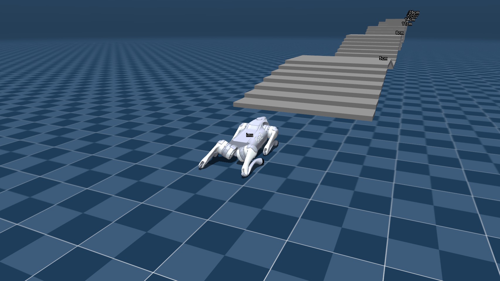
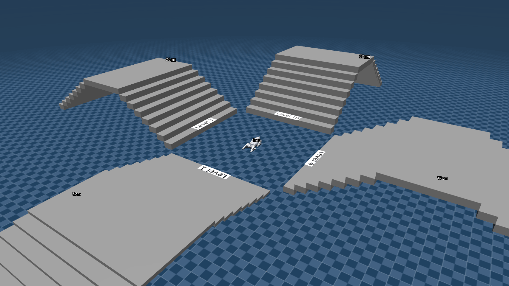
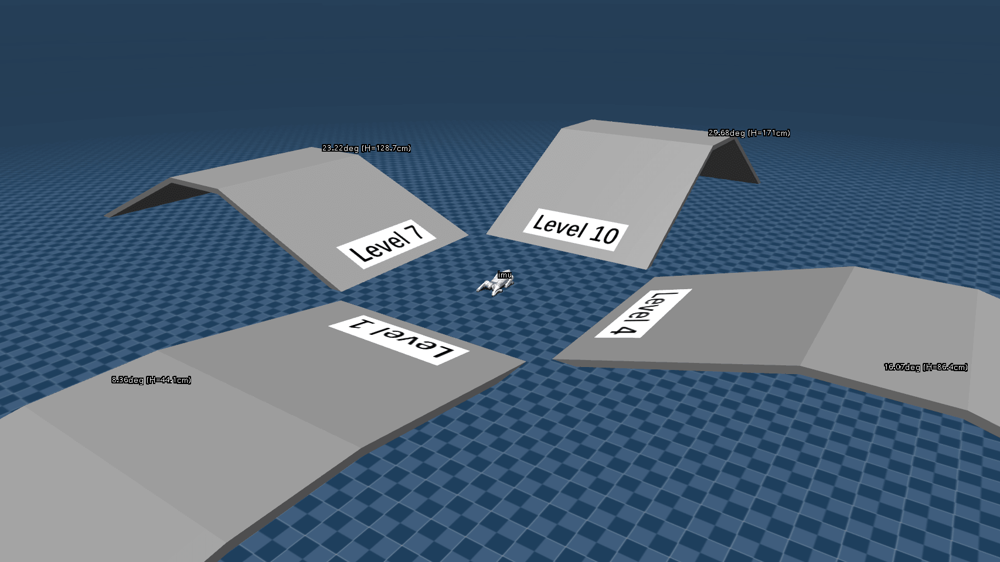
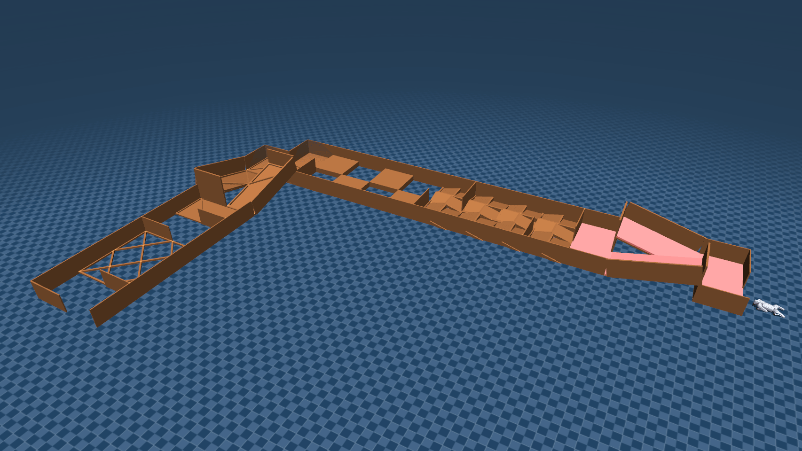
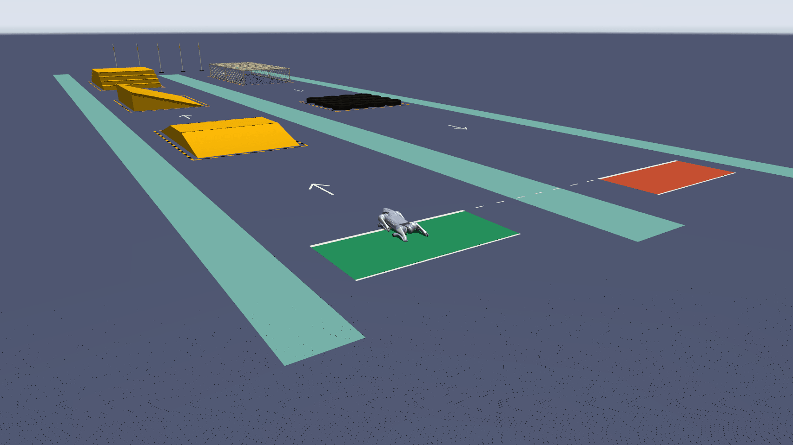

<div align="center">
  <h1>Unitree Go2 MuJoCo</h1>
  <p><strong>Go2 models, scenes, and a C++ MuJoCo simulator based on <a href="https://github.com/unitreerobotics/unitree_mujoco">unitreerobotics/unitree_mujoco</a>, with Unitree SDK2 communication</strong></p>
  <p><strong>🌎 English</strong>&nbsp;&nbsp;·&nbsp;&nbsp;<a href="README_zh.md">🇨🇳 中文</a></p>
</div>

<table>
  <tr>
    <td align="center" width="33%">
      <a href="asset/figures/flat.png"></a><br>
      <code>flat</code>
    </td>
    <td align="center" width="33%">
      <a href="asset/figures/stairs.png"></a><br>
      <code>stairs</code>
    </td>
    <td align="center" width="33%">
      <a href="asset/figures/cross_stairs.png"></a><br>
      <code>cross_stairs</code>
    </td>
  </tr>
  <tr>
    <td align="center" width="33%">
      <a href="asset/figures/cross_slope.png"></a><br>
      <code>cross_slope</code>
    </td>
    <td align="center" width="33%">
      <a href="asset/figures/race_track.png"></a><br>
      <code>race_track</code>
    </td>
    <td align="center" width="33%">
      <a href="asset/figures/racing.png"></a><br>
      <code>racing</code>
    </td>
  </tr>
</table>

> Press F7 three times to view stair and slope information

## Install & Build

Install the system libraries and [Unitree SDK2](https://github.com/unitreerobotics/unitree_sdk2). The SDK's DDS wrapper headers are required; `/opt/unitree_robotics` and standard installation prefixes are searched by CMake.

Download the archive for your platform from the [latest official MuJoCo release](https://github.com/google-deepmind/mujoco/releases/latest) and extract it.

```bash
git clone --single-branch --branch go2 https://github.com/wty-yy/unitree_mujoco.git unitree_mujoco_go2
cd unitree_mujoco_go2

sudo apt install cmake g++ libyaml-cpp-dev libspdlog-dev libboost-all-dev libglfw3-dev libfmt-dev

# Extract a MuJoCo release including its simulate sources, then link its versioned directory.
ln -s /path/to/mujoco-[version] simulate/mujoco
cmake -S simulate -B simulate/build -DCMAKE_BUILD_TYPE=Release
cmake --build simulate/build -j$(nproc)
```

## Run

The default configuration requires a gamepad connected to the host. Test gamepad input with `./simulate/build/jstest`; otherwise, disable gamepad input before starting the simulator.

```bash
./simulate/build/unitree_mujoco
./simulate/build/unitree_mujoco -s scene.xml
./simulate/build/unitree_mujoco -s obstacles.xml -i 0 -n lo
./simulate/build/unitree_mujoco --help
```

- `-s`, `--scene`: Scene file; overrides `robot_scene`, default `stairs.xml`. Relative paths resolve under `unitree_robots/go2/`; absolute paths are supported
- `-i`, `--domain_id`: DDS domain ID; overrides `domain_id`, default `0`
- `-n`, `--network`: DDS network interface; overrides `interface`, default `lo`
- `-h`, `--help`: Show command-line help and exit

Available scenes: `scene.xml`, `scene_terrain.xml`, `flat.xml`, `stairs.xml`, `cross_stairs.xml`, `cross_slope.xml`, `race_track.xml`, `racing.xml`, `four_platforms.xml`, `rough_flat.xml`, `wheel.xml`, and `obstacles.xml`.

Additional settings in [`simulate/config.yaml`](simulate/config.yaml):

- `use_joystick`: Enable gamepad input with `1` (default); use `0` when no gamepad is connected
- `joystick_type`: Gamepad layout, `xbox` (default) or `switch`
- `joystick_device`: Gamepad device path, default `/dev/input/js0`
- `joystick_bits`: Gamepad axis precision in bits, default `16`
- `print_scene_information`: Print links, joints, actuators, and sensors with `1` (default); disable with `0`
- `show_base_velocity`: Display base x/y and yaw velocity with `1` (default); disable with `0`

## Code Structure

```text
unitree_mujoco/
├── simulate/                    # C++ simulator
│   ├── CMakeLists.txt           # Build configuration
│   ├── config.yaml              # Simulation configuration
│   ├── mujoco/                  # Symlink to the MuJoCo installation
│   └── src/                     # Simulator, DDS bridge, and gamepad sources
└── unitree_robots/
    └── go2/                     # Go2 MJCF model and terrain scenes
```

## License

Original code in this repository is licensed under the [MIT License](LICENSE). Code derived from Unitree MuJoCo retains the BSD 3-Clause License included in the same file. Third-party code retains its respective licenses.
